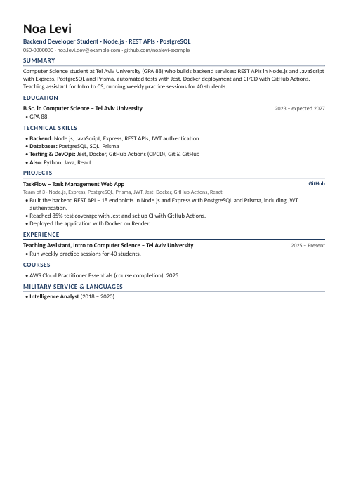
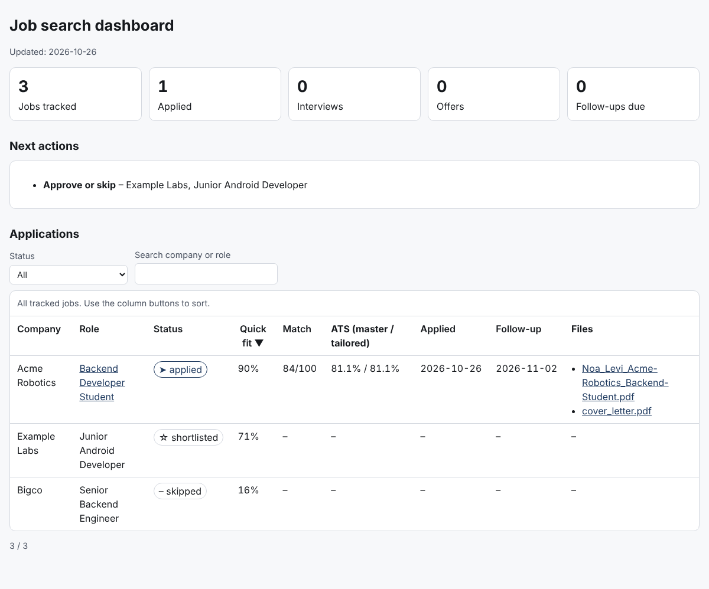

# Job Application Assistant – a Claude skill for landing tech interviews

**Drop in your old CV, projects and certificates → get a tailored one-page resume, cover letter, match
score and interview prep for every job → let Claude find jobs (LinkedIn alerts, job boards, WhatsApp
groups) and apply to the ones you approve.**

Made for tech job seekers – students and juniors especially – with Israeli job-market know-how and full
Hebrew support. No coding needed.

**[🇮🇱 עברית – התקנה ושימוש](#עברית)**

| Tailored one-page resume | Your applications dashboard |
|---|---|
|  |  |

---

## ⬇️ Install in 2 minutes (no coding)

**Claude app or claude.ai**

1. **Download the skill:** [`job-application-assistant.zip`](https://github.com/GalAshkenazi20/job-application-assistant/raw/main/install/job-application-assistant.zip) (don't unzip it).
2. In Claude open **Settings → Capabilities** and turn on **Code execution and file creation** (in newer versions: *Create and edit files*).
3. Open **Customize → Skills → `+` → Create skill → Upload a skill** and choose the ZIP.
4. Start a new chat and say: *"Create my job-search workspace"* – or just paste a job description.

> Tip: in the **Claude desktop app** you can connect a folder on your computer – your files then stay on
> your computer and Claude saves the PDFs right next to them.

**Claude Code**

```bash
git clone https://github.com/GalAshkenazi20/job-application-assistant ~/.claude/skills/job-application-assistant
```

**What you need:** a Claude plan with Skills ([see Anthropic's help article](https://support.claude.com/en/articles/12512180-use-skills-in-claude)).
Optional for automatic applying: the **Gmail** connector (sending emails with your PDF) and a browser
tool (Claude in Chrome or the desktop app's browser) for company application forms.

---

## What you can ask

| Say this | You get |
|---|---|
| "Here are my files" (attach or drop into `inbox/`) | A complete master resume built from all of them, with questions about anything unclear |
| *paste a job description or link* | Tailored resume PDF · cover letter · match analysis with fit % · interview prep · outreach messages |
| "Find me junior backend jobs and apply" | A ranked shortlist with match %, then – after **your one approval** – emails sent and forms filled |
| "Check my WhatsApp job groups" | Job posts pulled from chats you exported, deduplicated and ranked |
| "I need a recommendation letter from my lecturer" | A draft for your recommender to edit and sign |
| "Where do I stand?" | Your dashboard: every application, its score, files and follow-ups due |

## How it works

- **Master resume = single source of truth.** Every tailored resume is built only from facts in it.
- **ATS check.** ~140 technologies, weighted by priority (must-have > responsibilities > advantage),
  handles "one of Java, Go or C#" lists and the classic traps (C vs C++ vs C#, Java vs JavaScript,
  MySQL → SQL, "send your CV" ≠ computer vision).
- **Honest fit score.** Keyword coverage + seniority + eligibility – a "5+ years" role or a student role that
  needs "2 years left in the degree" never ranks high by accident.
- **Fact check.** Any skill or number in a tailored resume that your master resume doesn't contain is flagged.
- **Clean PDFs.** One page, single column, real text that ATS systems can read; Hebrew documents render
  right-to-left.

## Where jobs come from

- **LinkedIn** – through your own LinkedIn job-alert emails (Gmail connector). LinkedIn pages are never scraped.
- **Company career pages** – Comeet, Greenhouse, Lever, Workday, Amazon/Apple careers…
- **Job boards** – AllJobs, Drushim, JobMaster, Secret Tel Aviv…
- **WhatsApp groups** – export a group (*Export chat → Without media*), drop the file into `inbox/whatsapp/`.
  WhatsApp itself is never automated; sender names and phone numbers are removed.

## Principles

- **No invented experience.** Gaps are reported with a plan to close them – never hidden in the resume.
- **Nothing is sent without your approval.** One approval per round; a final confirmation before any
  website form is submitted. LinkedIn Easy Apply stays a click for you. No accounts, passwords or CAPTCHAs.
- **Your data stays yours.** Personal files live in your own workspace folder, never in this repository.
- **Scores are estimates of fit**, not predictions of a hiring decision.

## FAQ

**Do I need to know how to code?** No. You talk to Claude; the skill runs its own small tools.
**Is it only for Israel?** No – it works anywhere. Israeli sources and Hebrew support are a bonus.
**Will it spam companies?** No. It ranks jobs, applies only to the ones you approve, and caps each round.

## For developers

```
SKILL.md                 instructions Claude reads (routing, rules, tools)
references/              workflows: ingest, tailor, search & apply, resume writing, job sources
scripts/                 ats_match · build_pdf · ingest · tracker (+dashboard) · whatsapp_jobs · init_workspace · self_test
templates/               master resume, preferences, job, cover letter, recommendation draft, outreach, analysis, interview prep
assets/resume.css        single-column styling for resumes, letters and documents (RTL-aware)
examples/                a complete fictional run (Noa Levi @ Acme Robotics)
evals/                   test cases for `claude plugin eval`
install/                 the ready-to-upload ZIP
```

```bash
python3 scripts/self_test.py      # 56 checks: keyword traps, scoring, eligibility, fact check, ingest,
                                  # WhatsApp parsing, tracker, dashboard, PDF
```

Contributions welcome – new job sources, dictionary entries (`scripts/skills_dictionary.py`) and templates
for other markets. Please run the self-test before opening a PR and never commit real personal data.
If this helped you land an interview, a ⭐ helps other job seekers find it.

## License

MIT – see [LICENSE](LICENSE).

---

<div dir="rtl">

## עברית

**סקיל ל-Claude שעוזר להשיג ראיונות בהייטק – בלי לדעת לתכנת.**
גוררים קורות חיים ישנים, פרויקטים ותעודות, ומקבלים לכל משרה: קורות חיים מותאמים בעמוד אחד שעוברים
מערכות ATS, מכתב פנייה, ציון התאמה באחוזים, ניתוח פערים והכנה לראיון. אפשר גם לבקש מ-Claude למצוא
משרות (התראות לינקדאין, לוחות דרושים, קבוצות וואטסאפ), לדרג אותן ולהגיש למשרות שאישרת.

### התקנה ב-2 דקות

1. **מורידים את הקובץ:** [`job-application-assistant.zip`](https://github.com/GalAshkenazi20/job-application-assistant/raw/main/install/job-application-assistant.zip) (לא לפתוח אותו).
2. ב-Claude: **Settings ← Capabilities** ← מפעילים **Code execution and file creation**.
3. **Customize ← Skills ← `+` ← Create skill ← Upload a skill** ← בוחרים את קובץ ה-ZIP.
4. פותחים צ'אט חדש וכותבים: "צור לי תיקיית חיפוש עבודה" – או פשוט מדביקים תיאור משרה.

### מה אפשר לבקש

- "הנה הקבצים שלי" ← קורות חיים מלאים שנבנים מכל הקבצים
- מדביקים משרה ← חבילת מועמדות מלאה (קו"ח PDF, מכתב פנייה, ניתוח התאמה, הכנה לראיון)
- "תמצא לי משרות ותגיש" ← רשימה מדורגת באחוזים ← אישור אחד שלך ← הגשה
- "תבדוק את קבוצות הוואטסאפ" ← מייצאים קבוצה (ייצוא צ'אט ← ללא מדיה) לתיקייה `inbox/whatsapp`
- "מה המצב?" ← לוח בקרה עם כל המועמדויות (יש גרסה בעברית)

### עקרונות

בלי להמציא ניסיון · שום דבר לא נשלח בלי אישור שלך · LinkedIn Easy Apply נשאר בלחיצה שלך ·
המידע האישי נשאר אצלך ולא עולה לריפו הזה.

</div>
